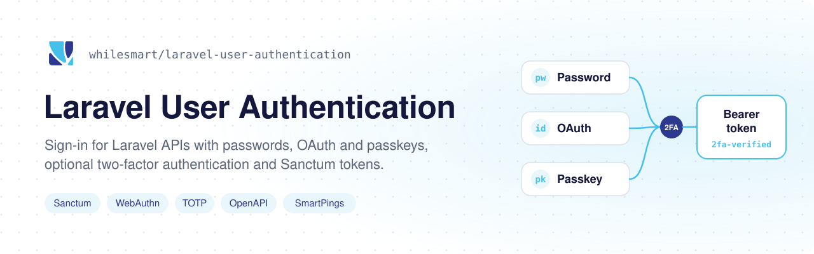
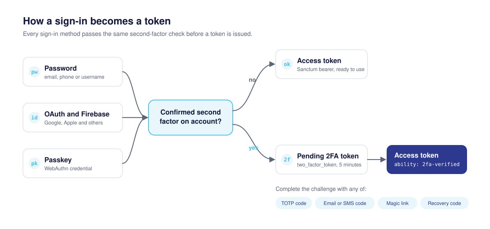

<picture>
  <source media="(prefers-color-scheme: dark)" srcset=".github/assets/banner-dark.svg">
  
</picture>

[](https://packagist.org/packages/whilesmart/laravel-user-authentication)
[](https://github.com/whilesmartphp/laravel-user-authentication/actions/workflows/tests.yml)
[](LICENSE)

Authentication endpoints for Laravel APIs. Users register and sign in with a password, OAuth, Firebase or a passkey, and receive a Sanctum access token once any second factor is checked. Install the package and run its migrations to enable the routes.

## What you get

| Area | Included |
| --- | --- |
| Accounts | Registration, login by email, phone or username, logout, password reset by code |
| Email sign-in | Optional passwordless sign-in with an emailed code or magic link |
| Social sign-in | Socialite drivers (Google, Apple and others) and Firebase ID tokens |
| Passkeys | WebAuthn registration and login, with optional discoverable credentials |
| Two-factor | TOTP apps, email and SMS codes, magic links, recovery codes, several labeled factors per user |
| Verification | Email or phone verification before registration, sent by your own listeners or by SmartPings |
| Integration | Events, before and after hooks, a swappable response format, OpenAPI attributes |

## Install

Requires PHP 8.3 or later and Laravel Sanctum.

```bash
composer require whilesmart/laravel-user-authentication
php artisan migrate
```

The service provider registers itself and loads its routes under `/api`. Change the prefix with `USER_AUTH_ROUTE_PREFIX`. The [installation guide](docs/installation.md) covers publishing the config, migrations, routes and controllers.

## How sign-in works

<picture>
  <source media="(prefers-color-scheme: dark)" srcset=".github/assets/sign-in-flow-dark.svg">
  
</picture>

A user without a second factor gets an access token straight away:

```http
POST /api/login
{"email": "ada@example.com", "password": "secret-password"}
```

```json
{
  "success": true,
  "message": "User successfully logged in",
  "data": {
    "token": "1|abc...",
    "token_type": "Bearer",
    "user": {"id": 1, "email": "ada@example.com"}
  }
}
```

A user with a confirmed second factor gets a pending two-factor token instead of an access token:

```json
{
  "success": true,
  "message": "Two-factor authentication required.",
  "data": {
    "two_factor_required": true,
    "factor_id": 1,
    "method": "totp",
    "two_factor_token": "<pending-token>",
    "factors": [{"id": 1, "type": "totp", "label": "Phone"}]
  }
}
```

Send `two_factor_token` and a code to `POST /api/2fa/verify` to receive an access token. Protect your own routes with `['auth:sanctum', 'two-factor']` so tokens that skipped the second factor are refused. The [two-factor guide](docs/two-factor-authentication.md) covers enrollment, resending, magic links and recovery codes.

## Configuration

Most settings read an environment variable. The ones most installs touch:

| Variable | Default | Purpose |
| --- | --- | --- |
| `USER_AUTH_ROUTE_PREFIX` | `api` | Prefix for every package route |
| `USER_AUTH_REQUIRE_EMAIL_VERIFICATION` | `false` | Require a verified email before registration |
| `USER_AUTH_REQUIRE_PHONE_VERIFICATION` | `false` | Require a verified phone before registration |
| `USER_AUTH_VERIFICATION_PROVIDER` | `default` | `default` or `smartpings` |
| `USER_AUTH_SELF_MANAGED` | `true` | Set to `false` to let SmartPings send and check codes |
| `USER_AUTH_MAGIC_LINK_URL` | none | Frontend page that receives two-factor magic links |
| `USER_AUTH_EMAIL_LOGIN_ENABLED` | `false` | Turn on passwordless email sign-in |
| `USER_AUTH_EMAIL_LOGIN_CREATE_USERS` | `false` | Create an account for an unknown email on sign-in |
| `USER_AUTH_EMAIL_LOGIN_URL` | none | Frontend page that receives email sign-in links |
| `USER_AUTH_PASSKEY_DOMAIN` | none | Domain that identifies your app to passkeys, as a hostname or URL |
| `USER_AUTH_PASSKEY_ALLOWED_ORIGINS` | none | Frontend origins allowed to register and use passkeys |

The full list, with rate limits and expiry times, is in [`config/user-authentication.php`](config/user-authentication.php) and the guides below.

Two-factor challenges expire but stay in the database until pruned. Schedule pruning in your application:

```php
use Illuminate\Support\Facades\Schedule;
use Whilesmart\UserAuthentication\Models\AuthChallenge;

Schedule::command('model:prune', ['--model' => [AuthChallenge::class]])->daily();
```

## Custom user model

Set `user_model` in the config. Add `HasApiTokens`, `HasPasskeys` and `HasTwoFactorAuth` to your model. The two-factor middleware requires `HasTwoFactorAuth`.

```php
use Laravel\Sanctum\HasApiTokens;
use Whilesmart\UserAuthentication\Traits\HasPasskeys;
use Whilesmart\UserAuthentication\Traits\HasTwoFactorAuth;

class User extends Authenticatable
{
    use HasApiTokens, HasPasskeys, HasTwoFactorAuth;
}
```

## Endpoints

All paths use the default `/api` prefix.

| Method | Path | Notes |
| --- | --- | --- |
| `POST` | `/register` | |
| `POST` | `/login` | Email, phone or username with a password |
| `POST` | `/login/email` | Sends a code, plus a link when a URL is set; returns 202 |
| `POST` | `/login/email/verify` | `{email, code}` or `{token}` |
| `POST` | `/logout` | Signed in |
| `POST` | `/send-verification-code` | |
| `POST` | `/verify-code` | |
| `POST` | `/password/reset-code` | |
| `POST` | `/password/reset` | |
| `GET` | `/oauth/{driver}/login` | |
| `GET` `POST` | `/oauth/{driver}/callback` | |
| `POST` | `/oauth/firebase/{driver}/callback` | See [kreait/laravel-firebase](https://github.com/kreait/laravel-firebase) for setup |
| `POST` | `/passkeys/login/options` | |
| `POST` | `/passkeys/login` | |
| `POST` | `/passkeys/register/options` | Signed in |
| `POST` | `/passkeys/register` | Signed in |
| `GET` | `/passkeys` | Signed in |
| `DELETE` | `/passkeys/{id}` | Signed in |
| `POST` | `/2fa/verify` | Pending token and code |
| `POST` | `/2fa/resend` | Pending token and factor |
| `POST` | `/2fa/verify-link` | Pending token and magic link token |
| `GET` | `/2fa/factors` | Signed in |
| `POST` | `/2fa/setup` | Signed in |
| `POST` | `/2fa/confirm` | Signed in |
| `POST` | `/2fa/disable` | Signed in |
| `POST` | `/2fa/recovery-codes` | Signed in |

"Signed in" routes use `auth:sanctum` and `two-factor`. Sending verification and password reset codes, passkey sign-in and registration, and every two-factor route except `/2fa/factors` are rate limited.

## Events

Listen to these to send mail and SMS, write audit logs or sync other systems:

| Event | Fired when |
| --- | --- |
| `UserRegisteredEvent` | A user registers |
| `UserLoggedInEvent` | A sign-in completes, including after the second factor |
| `UserLoggedOutEvent` | A user logs out |
| `OauthUserAuthenticatedEvent` | An OAuth or Firebase sign-in resolves a user |
| `VerificationCodeGeneratedEvent` | A verification or two-factor code is created; carries the magic link when there is one |
| `PasswordResetCodeGeneratedEvent` | A password reset code is created |
| `PasswordResetCompleteEvent` | A password is reset |

## Apple sign-in

Apple sign-in comes from Socialite Providers. Follow [their Apple setup](https://socialiteproviders.com/Apple/#installation-basic-usage), then use `apple` as the driver.

## OpenAPI

Publish the documentation class so your OpenAPI generator picks up the endpoints:

```bash
php artisan vendor:publish --tag=laravel-user-authentication-docs
```

This creates `app/Http/Documentation/UserAuthOpenApiDocs.php`.

## Guides

| Guide | Covers |
| --- | --- |
| [Installation](docs/installation.md) | Setup and publishing |
| [Verification](docs/verification.md) | Email and phone verification with your provider or SmartPings |
| [Email sign-in](docs/email-login.md) | Codes, links, account creation and delivery events |
| [Passkeys](docs/passkey.md) | WebAuthn settings and troubleshooting |
| [Two-factor authentication](docs/two-factor-authentication.md) | Factors, challenges, magic links, recovery codes |
| [Customization](docs/customization.md) | Response format, middleware hooks |

The same guides are published at [developers.whilesmart.com](https://developers.whilesmart.com/packages/php/laravel/laravel-user-authentication).

## Development

```bash
make setup      # start the containers, install dependencies, run the tests
composer test   # PHPUnit through Orchestra Testbench
composer lint   # Laravel Pint
composer phpstan
composer phpmd
```

## License

MIT. See [LICENSE](LICENSE).
